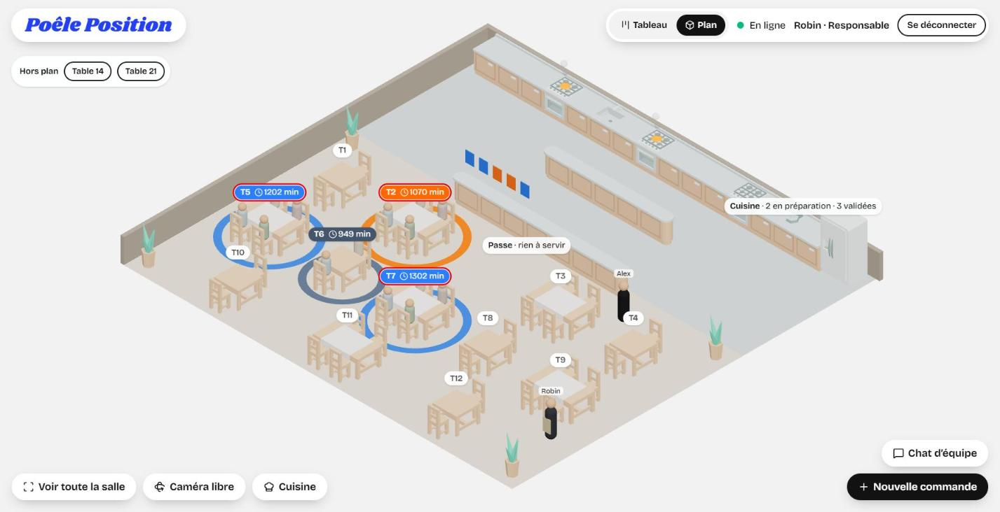
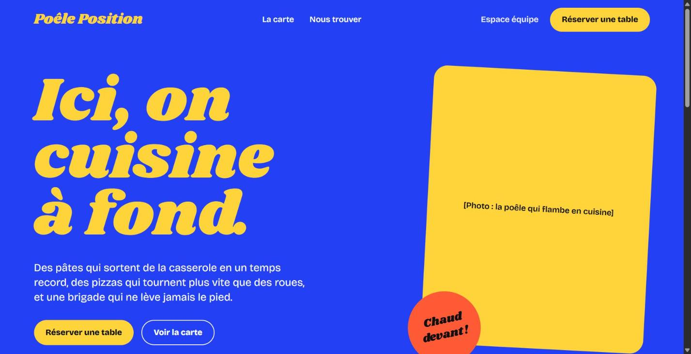
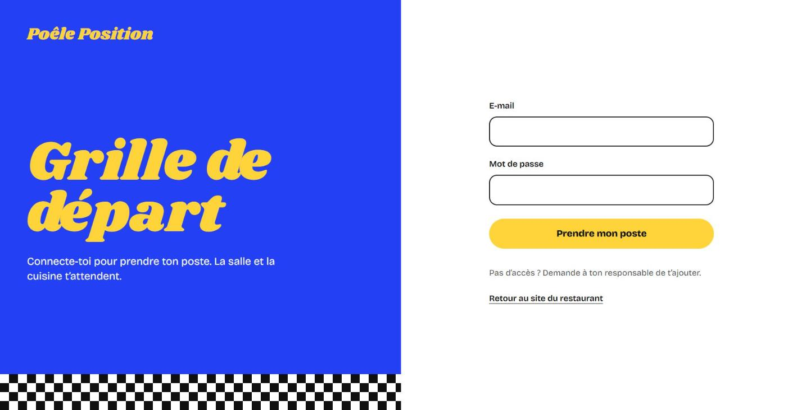
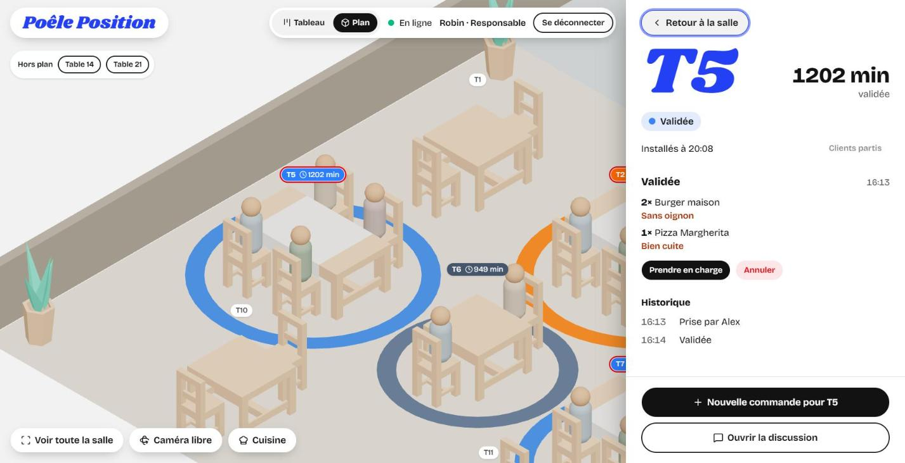
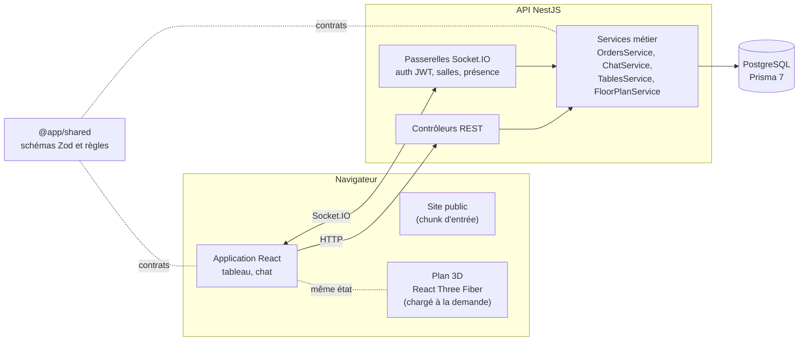
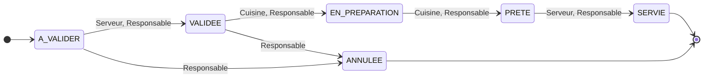
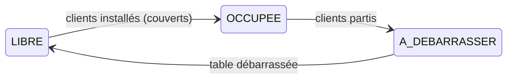
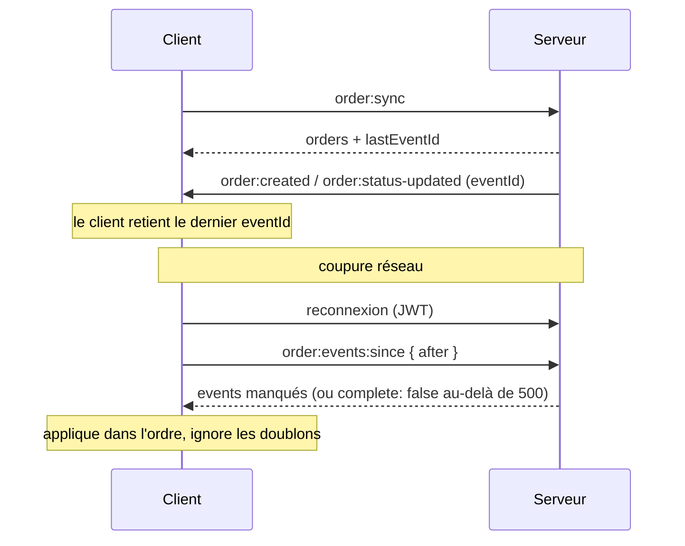

<div align="center">


# Poêle Position

**Le service d'un restaurant, en temps réel.**
Prise de commande, cuisine, plan de salle 3D et chat d'équipe, synchronisés par Socket.IO.

<br />


<br />

[Démarrer](#démarrage-rapide) · [Tester](#tester-lapplication) · [Architecture](#architecture) · [API REST](#api-rest) · [Socket.IO](#contrats-socketio)

</div>

<br />

<p align="center">
  
</p>

> [!NOTE]
> Projet réalisé dans le cadre du module **Web Temps Réel** (Master 2). L'énoncé
> est dans [`docs/sujet.md`](docs/sujet.md). Le restaurant de démonstration,
> **Poêle Position**, joue sur la « pole position » de la course automobile :
> vitesse, chrono, départ, arrivée.

## Sommaire

- [Aperçu](#aperçu)
- [Fonctionnalités](#fonctionnalités)
- [Stack technique](#stack-technique)
- [Démarrage rapide](#démarrage-rapide)
- [Tester l'application](#tester-lapplication)
- [Architecture](#architecture)
- [Règles métier](#règles-métier)
- [API REST](#api-rest)
- [Contrats Socket.IO](#contrats-socketio)
- [Reconnexion et journal d'événements](#reconnexion-et-journal-dévénements)
- [Développement sans Docker](#développement-sans-docker)
- [Tests](#tests)
- [Identité visuelle](#identité-visuelle)
- [Dépannage](#dépannage)
- [Crédits](#crédits)

## Aperçu

<table>
  <tr>
    <td width="50%"></td>
    <td width="50%"></td>
  </tr>
  <tr>
    <td align="center"><sub><b>Site du restaurant</b> : page publique, accès « Espace équipe »</sub></td>
    <td align="center"><sub><b>Grille de départ</b> : connexion de l'équipe</sub></td>
  </tr>
  <tr>
    <td width="50%"></td>
    <td width="50%"></td>
  </tr>
  <tr>
    <td align="center"><sub><b>Plan de salle 3D</b> : états des tables, cuisine, personnel</sub></td>
    <td align="center"><sub><b>Panneau de table</b> : commande, historique, actions</sub></td>
  </tr>
</table>

## Fonctionnalités

### Par rôle

| Rôle | Ce qu'il fait |
|---|---|
| **Serveur** (salle) | Prend les commandes depuis la carte (photo de chaque plat, quantité, contrainte par plat comme « sans oignon », commentaire). Ne voit que ses commandes. Valide, puis sert quand c'est prêt. Installe les clients et libère les tables. |
| **Cuisine** | Prend en charge les commandes validées, puis les marque prêtes. Arrive sur le plan cadré sur la cuisine. |
| **Responsable** | Voit toutes les commandes du restaurant, peut effectuer toutes les transitions et est le seul à pouvoir annuler. |
| **Manager** | Modifie le plan de salle (vue de dessus, grille de 25 cm, ajout, retrait, numéro, forme). Chevauchements et sorties de salle sont signalés avant d'enregistrer. |

### Pour toute l'équipe

- **Site public et connexion** : landing du restaurant (`/`), connexion (`/connexion`), application (`/service`), avec redirections selon l'état de connexion.
- **Tableau kanban** : À valider, Validée, En préparation, Prête, mis à jour en direct.
- **Plan de salle 3D en plein écran** (vue par défaut)
  - Chaque table prend la couleur de sa commande la plus urgente, avec le nombre de commandes, le temps d'attente et les messages non lus ; les tables en retard sont signalées.
  - Cadrage automatique de toute la salle et de la cuisine, quel que soit le format de l'écran ; boutons « Voir toute la salle », « Caméra libre » et « Cuisine ».
  - Un clic sur une table ouvre un panneau latéral (une feuille en bas sur mobile) et la caméra zoome sur elle : état, temps écoulé, commande, historique, actions du kanban et nouvelle commande pour cette table. Échap, « Retour à la salle » ou un clic dans le vide ramènent la vue d'ensemble.
  - Cuisine vivante : trois fourneaux, un îlot central et le passe. Chaque cuisinier connecté a un poste et cuisine en boucle tant qu'une commande est en préparation ; les fourneaux actifs flambent et fument.
  - Les événements en direct sont animés (ticket vers la cuisine, assiette du fourneau au passe puis à la table) et le personnel connecté se déplace par les allées.
  - Seuls les états des tables sont en couleurs saturées, et seuls ceux sur lesquels le rôle connecté peut agir clignotent.
- **Chat d'équipe** : canal Général, canaux Cuisine et Salle selon le rôle, une discussion par commande ; historique et personnes en ligne. Panneau rétractable en vue Plan.
- **Résilience** : indicateur de connexion, bandeau de reconnexion, rattrapage automatique des événements manqués après une coupure.
- **Erreurs explicites** quand une action est refusée (droits, modification concurrente, transition invalide).
- **Accessibilité** : contraste AA, navigation au clavier, focus visible, cibles tactiles de 44 px, respect de « réduire les animations ».

## Stack technique

| Couche | Technologies | Rôle |
|---|---|---|
| **Front** |      | Interface, routes découpées par écran, design system |
| **3D** |   | Plan de salle isométrique, chargé à la demande |
| **Temps réel** |  | Commandes, occupation des tables, chat, présence |
| **API** |   | REST, passerelles Socket.IO, authentification |
| **Données** |   | Modèle, migrations, journal d'événements |
| **Contrats** |   | Schémas partagés entre front et API |
| **Outillage** |     | Environnement, tests, qualité |

## Démarrage rapide

> [!IMPORTANT]
> Prérequis : **Docker** et **Docker Compose**.

```bash
docker compose up --build
```

Au démarrage, le conteneur `api` applique les migrations
(`prisma migrate deploy`) puis charge les données de démo (`prisma db seed`,
idempotent). Aucune autre commande n'est nécessaire.

| Service | URL |
|---|---|
| Application | http://localhost:5173 |
| API | http://localhost:3001 (`/health` vérifie la base) |
| PostgreSQL | localhost:5432 |

**Comptes de démo** (mot de passe commun `password123`) :

| Rôle | E-mail |
|---|---|
| Serveur | `serveur@chez-demo.local` |
| Cuisine | `cuisine@chez-demo.local` |
| Responsable | `responsable@chez-demo.local` |
| Manager (administration, canal Général uniquement) | `manager@chez-demo.local` |

Un fichier `.env` (copie de [`.env.example`](.env.example)) n'est utile que
pour changer les valeurs par défaut : ports, identifiants PostgreSQL, secret JWT.

## Tester l'application

### Parcours

| Adresse | Écran | Accès |
|---|---|---|
| http://localhost:5173/ | Site du restaurant « Poêle Position » | public |
| http://localhost:5173/connexion | Connexion de l'équipe (« Grille de départ ») | public |
| http://localhost:5173/service | Tableau et plan de salle | connecté |

Depuis le site, « Espace équipe » mène à la connexion. Une personne déjà
connectée qui ouvre `/connexion` est renvoyée vers `/service`, et une personne
non connectée qui ouvre `/service` est renvoyée vers `/connexion`.

### Ce que chaque compte permet de vérifier

| Compte | À tester |
|---|---|
| `serveur@chez-demo.local` | Ne voit que ses commandes. Crée une commande, la valide, la sert. Installe des clients, puis « Clients partis » et « Table débarrassée ». Sur le plan, seules ses tables « À valider » et « Prête » clignotent. |
| `cuisine@chez-demo.local` | Arrive sur le plan cadré sur la cuisine. Prend en charge une commande validée, puis la marque prête. Son personnage cuisine à son fourneau tant qu'une commande est en préparation (un fourneau allumé par commande, trois au plus). Rien ne clignote en salle. |
| `responsable@chez-demo.local` | Voit toutes les commandes et peut tout faire, y compris annuler. Seules les tables « Prête » clignotent. |
| `manager@chez-demo.local` | Voit tout sans changer les statuts. En vue Plan, « Modifier le plan » ouvre l'éditeur de salle. |

> [!TIP]
> Les onglets d'une même fenêtre partagent la session. Ouvrir chaque compte
> dans une **fenêtre de navigation privée** ou un **autre navigateur** (le
> serveur d'un côté, la cuisine de l'autre) pour voir les commandes, le chat,
> les personnages et les animations se mettre à jour en direct.

### Scénario conseillé

1. **Serveur** : « Nouvelle commande » pour une table, puis « Valider ».
   Toast « Feu vert, T… part en cuisine. »
2. **Cuisine** : « Prendre en charge ». Un fourneau s'allume, avec flamme et
   fumée, et le cuisinier saute la poêle à son poste.
3. **Cuisine** : « Marquer prête ». Le cuisinier va au passe, une assiette y
   apparaît, et la table clignote chez le serveur.
4. **Serveur** : « Marquer servie ». Toast « T… servie. »
5. **Serveur** : « Clients partis », puis « Table débarrassée ».

### Vue Plan

- C'est la vue affichée par défaut après la connexion (le choix « Tableau »
  est mémorisé ; sans WebGL, l'application reste sur le tableau). La scène
  occupe tout l'écran, salle et cuisine entièrement visibles quel que soit le
  format de la fenêtre.
- En bas à gauche : « Voir toute la salle », « Caméra libre », « Cuisine ».
- Clic sur une table : panneau à droite et zoom animé sur la table. Échap,
  « Retour à la salle » ou un clic dans le vide ramènent la vue d'ensemble.
  Un glissé pour déplacer la vue ne ferme pas le panneau.
- Sous 768 px de large, le panneau devient une feuille qui monte du bas.
- « Chat d'équipe » en bas à droite ouvre le chat ; « Ouvrir la discussion »
  depuis le panneau d'une table l'ouvre sur cette commande.

### Cas particuliers

| Cas | Comment le tester | Résultat attendu |
|---|---|---|
| Animations réduites | Windows : Paramètres > Accessibilité > Effets visuels > Effets d'animation désactivés | Caméra placée sans animation ; cuisiniers, flammes et fumée immobiles ; plus de clignotement |
| Coupure réseau | `docker compose stop api`, puis `docker compose start api` | Bandeau « Connexion perdue. On se reconnecte… », puis rattrapage de l'état |
| Mobile | Outils de développement, mode appareil, 390 px de large | En-tête sur une ligne ; prénom, rôle et déconnexion dans le menu du compte ; panneau de table en feuille |
| Données de démo | `docker compose down -v`, puis `docker compose up --build` | Base vide puis seed (efface toutes les données) |

À chaque démarrage, le seed crée les comptes, la carte et les 12 tables de
démo s'ils manquent, et remet plats et tables à leurs valeurs de démo, sans
toucher aux commandes ni au chat.

## Architecture



Monorepo npm workspaces :

```text
apps/
  api/      NestJS 12 (Node 22, ESM) + Prisma 7 + PostgreSQL + Socket.IO
  web/      React 19 + Vite + React Router + Tailwind CSS + shadcn/ui + React Three Fiber
shared/     @app/shared : schémas Zod et types communs au front et à l'API
docs/       énoncé du cours, handoff de l'identité visuelle, captures
scripts/    outillage Docker (binaires natifs Linux)
docker-compose.yml
```

### Principes

- **`shared` est la source unique des contrats** : schémas Zod des commandes,
  des plats et des messages, noms des événements Socket.IO, règles de
  transition et de droits. Le front et l'API valident les mêmes données avec
  les mêmes schémas.
- **Le serveur est l'autorité** : un client ne modifie jamais l'état
  directement. Il envoie une demande, reçoit un accusé de réception, puis
  l'état change à réception de l'événement publié par le serveur, émetteur
  compris.
- **Une seule connexion Socket.IO** par client, partagée par le tableau et le
  chat. L'identité vient du jeton JWT vérifié à la poignée de main, jamais du
  contenu des messages.
- **Mêmes règles en REST et en Socket.IO** : les deux passent par les mêmes
  services.

### API (`apps/api/src`)

| Module | Rôle |
|---|---|
| `auth`, `users` | Inscription, connexion, JWT (bcrypt pour les mots de passe) |
| `realtime` | Connexion Socket.IO : authentification, salles selon le rôle, présence |
| `orders` | Commandes : REST, passerelle Socket.IO, journal d'événements |
| `chat` | Canaux, messages, historique, limite de fréquence |
| `dishes` | Carte du restaurant |
| `floor-plan` | Plan de salle, occupation des tables, éditeur du manager |

### Front (`apps/web/src`)

| Élément | Rôle |
|---|---|
| `routes/` | `landing-page` (chunk d'entrée), `team-layout` (auth et toasts), `login-page`, `service-page`, chargés à la demande |
| `lib/use-realtime-socket.ts` | Connexion Socket.IO et accusés de réception |
| `lib/use-orders-realtime.ts` | Tableau des commandes et rattrapage |
| `lib/use-tables-realtime.ts` | Occupation des tables |
| `lib/use-chat.ts` | Chat et présence |
| `components/floor-plan/` | Plan de salle 3D, panneau de table, éditeur |

**Découpage du bundle.** La landing est dans le chunk d'entrée (~77 Ko gzip)
et ne charge ni l'API, ni l'authentification, ni Three.js. L'espace équipe est
chargé à la connexion, et le plan 3D (~296 Ko gzip, dont three) seulement à
l'ouverture de la vue Plan.

**Plan de salle.** Le plan est une seconde vue branchée sur le même état
qu'`OrderBoard` : il ne se connecte pas au socket. `floor-scene-model.ts`
déduit l'état de chaque table des commandes et `camera-framing.ts` calcule le
cadrage isométrique (fonctions pures, testées) ; la scène ne fait que les
afficher. Les tables viennent de `GET /floor-plan` ; la pièce, la cuisine et le
passe sont fixes, dans `floor-plan-data.ts`. Les commandes dont la table n'y
figure pas apparaissent dans « Hors plan ». La scène n'est rendue que quand
quelque chose change, et elle est remplacée par le kanban si WebGL est
indisponible ou perdu. Les modèles `.glb` (11 fichiers, ~47 Ko gzip) sont
servis depuis `public/` ; tant qu'ils chargent, ou s'ils échouent, le mobilier
est dessiné en formes simples.

**Animations.** Elles partent des événements reçus en direct (`onLiveEvent` de
`useOrdersRealtime`), jamais de ceux rejoués lors d'un rattrapage : après une
coupure, la scène se remet à jour sans rejouer d'animations.
`order-effects.ts` traduit un événement en effet (fonction pure, testée), avec
un plafond de 6 effets en 2 secondes ; rien n'est animé onglet masqué ou avec
« réduire les animations ».

## Règles métier

### Cycle de vie d'une commande



| Transition vers | Rôles autorisés |
|---|---|
| Validée | Serveur, Responsable |
| En préparation | Cuisine, Responsable |
| Prête | Cuisine, Responsable |
| Servie | Serveur, Responsable |
| Annulée | Responsable |

Toute demande précise le statut attendu (`expectedStatus`). Si la commande a
été modifiée entre-temps par quelqu'un d'autre, la demande est refusée
(`409 STATUS_CONFLICT`) ; la vérification et la mise à jour sont atomiques.

Un serveur ne voit et ne modifie que ses propres commandes ; les autres rôles
voient toutes celles du restaurant. Le nom et le prix des plats sont lus dans
la carte côté serveur, jamais fournis par le client.

### Plan de salle et occupation des tables



Les tables du restaurant (`DiningTable`, cf. [`shared/src/floor.ts`](shared/src/floor.ts))
forment son plan de salle ; le seed en crée 12 pour le restaurant de démo. Si
un restaurant a un plan, une commande (REST ou Socket.IO) pour une table qui
n'y figure pas est refusée avec `UNKNOWN_TABLE`. Un restaurant sans plan
accepte tout numéro de table.

Serveurs et responsable font évoluer l'occupation ; la cuisine et le manager
la voient. Une commande prise à une table libre l'occupe automatiquement, et
une table ne passe pas « à débarrasser » tant qu'elle a des commandes en cours
(`TABLE_HAS_ACTIVE_ORDERS`). L'occupation est visible par tout le restaurant :
elle ne dit rien des commandes, un serveur voit donc qu'une table de son
collègue est occupée.

Le manager modifie le plan (`PUT /floor-plan`) en renvoyant toutes les tables
et la `version` du plan sur laquelle il a travaillé : si le plan a changé
entre-temps, l'enregistrement est refusé (`FLOOR_PLAN_CONFLICT`). Le serveur
vérifie les mêmes règles que l'éditeur (numéros uniques, places selon la forme,
tables dans la salle, sans chevauchement) et refuse de retirer une table
occupée ou qui a des commandes en cours (`TABLE_IN_USE`). Le nouveau plan est
diffusé à tout le restaurant (`floor:updated`).

### Canaux de chat

| Canal | Accès |
|---|---|
| Général | Tous |
| Cuisine | Cuisine, Responsable |
| Salle | Serveur, Responsable |
| Discussion d'une commande | Serveur (ses commandes), Cuisine, Responsable |

Les messages sont enregistrés en base (500 caractères au plus, 5 messages par
tranche de 10 secondes et par connexion). Un message renvoyé après une coupure
n'est pas dupliqué (`clientMessageId`).

## API REST

Toutes les routes sauf `/health` et `/auth/*` exigent un jeton
(`Authorization: Bearer <token>`). Le restaurant et l'auteur sont déduits du
jeton.

| Méthode | Route | Description |
|---|---|---|
|  | `/health` | État de l'API et de la base |
|  | `/auth/register` | Création de compte |
|  | `/auth/login` | Connexion, renvoie le jeton |
|  | `/dishes` | Carte du restaurant |
|  | `/floor-plan` | Plan de salle : `{ version, tables: [{ number, x, z, shape, seats }] }` |
|  | `/floor-plan` | Remplace le plan (manager) : `{ expectedVersion, tables }` |
|  | `/floor-plan/tables/:number/status` | Occupation d'une table : `{ expectedStatus, requestedStatus, guests? }` |
|  | `/orders?status=` | Commandes visibles (en cours par défaut) |
|  | `/orders` | Création d'une commande (idempotente via `clientOrderId`) |
|  | `/orders/:orderId/status` | Demande de transition |

Les écritures faites en REST sont publiées aux clients Socket.IO comme celles
faites par le socket.

## Contrats Socket.IO

Les types sont définis dans [`shared/src/realtime.ts`](shared/src/realtime.ts)
et [`shared/src/chat.ts`](shared/src/chat.ts).

**Envoyés par le client**, avec accusé de réception `{ accepted: true, ... }`
ou `{ accepted: false, errorCode, message }` :

| Événement | Données | Accusé |
|---|---|---|
| `order:create` | `{ tableNumber, items: [{ dishId, quantity, note? }], comment?, clientOrderId }` | `orderId` |
| `order:status:update` | `{ orderId, expectedStatus, requestedStatus }` | `orderId` |
| `order:sync` | `{}` | `orders`, `lastEventId` |
| `order:events:since` | `{ after }` | `events`, `complete` |
| `chat:channel:join` | `{ channelId }` | `messages` (50 derniers) |
| `chat:channel:leave` | `{ channelId }` | — |
| `chat:message:create` | `{ channelId, clientMessageId, content }` | `messageId` |
| `table:sync` | `{}` | `tables` (occupation de toutes les tables) |
| `table:status:update` | `{ tableNumber, expectedStatus, requestedStatus, guests? }` | `tableNumber` |

**Publiés par le serveur** :

| Événement | Destinataires |
|---|---|
| `order:created` | Rôles qui voient tout le tableau et serveur de la commande |
| `order:status-updated` | Idem |
| `chat:message:created` | Membres du canal |
| `presence:updated` | Tout le restaurant |
| `table:status-updated` | Tout le restaurant |
| `floor:updated` | Tout le restaurant (nouveau plan de salle) |

**Salles** : `restaurant:<id>` (canal Général et présence),
`restaurant:<id>:kitchen`, `restaurant:<id>:service`,
`restaurant:<id>:orders` (tableau complet), `user:<id>` (serveur de la
commande), `order:<id>` (discussion d'une commande). Une salle ne fait que
router la diffusion : les droits sont vérifiés à chaque action.

## Reconnexion et journal d'événements

Chaque création de commande et chaque changement de statut est enregistré dans
le journal (`OrderEvent`), dans la même transaction que la modification.
L'identifiant croissant de l'entrée sert d'`eventId`.



1. À la première connexion, le client demande un instantané (`order:sync`) et
   retient la position du journal.
2. À chaque événement reçu, il met à jour cette position.
3. À la reconnexion, il demande les événements manqués (`order:events:since`).
   Au-delà de 500 événements, il refait un instantané.
4. Les événements reçus pendant le rattrapage sont mis en attente puis
   appliqués dans l'ordre ; un événement déjà appliqué est ignoré.

Le chat recharge l'historique de chaque canal ouvert à la reconnexion.

L'occupation des tables n'a pas de journal : l'état est petit et chaque table
porte une `version`. À chaque (re)connexion, le client recharge l'instantané
`table:sync` et garde, table par table, l'état de version la plus haute, qu'il
vienne de l'instantané ou d'un événement.

## Développement sans Docker

Prérequis : Node 22 et un PostgreSQL accessible (par exemple
`docker compose up postgres`).

```bash
npm install
cp apps/api/.env.example apps/api/.env
cp apps/web/.env.example apps/web/.env

cd apps/api
npx prisma migrate deploy
npx prisma generate
npx prisma db seed
cd ../..

npm run dev:api   # http://localhost:3001
npm run dev:web   # http://localhost:5173
```

Après une modification du schéma : `npx prisma migrate dev --name <nom>` puis
`npx prisma generate` (Prisma 7 ne régénère plus le client automatiquement).

## Tests

| Périmètre | Commande | Contenu |
|---|---|---|
| API, bout en bout | `cd apps/api && npm run test:e2e` | REST et Socket.IO, sur la base de `apps/api/.env` |
| API, unitaires | `cd apps/api && npm test` | Tests unitaires de l'API |
| Front | `npm test --workspace apps/web` | Modèle du plan, cadrage caméra, trajets, effets, textes |
| Qualité | `npm run lint --workspace apps/api` et `--workspace apps/web` | Oxlint |

Les tests de l'API peuvent aussi être lancés dans le conteneur :
`docker compose exec api npm run test:e2e --workspace apps/api`.

## Identité visuelle

| | Couleur | Usage |
|---|---|---|
|  | Bleu piste `#2340f5` | Logo, grands titres, site et connexion |
|  | Jaune drapeau `#ffd43b` | Boutons du site, titres sur fond bleu |
|  | Noir `#101010` | Texte, boutons de l'application, damier |
|  | Orange pastille `#ff5a36` | Pastille « Chaud devant ! » du site |

- **Typographies** : [Shrikhand](https://fonts.google.com/specimen/Shrikhand)
  pour les titres display, [Bricolage Grotesque](https://fonts.google.com/specimen/Bricolage+Grotesque)
  pour tout le reste, auto-hébergées (sous-ensemble latin).
- **Signature** : le damier noir et blanc, en bandes de séparation.
- **Dans l'application**, le bleu et le jaune ne servent qu'au logo, aux grands
  titres et à la connexion, pour ne pas se confondre avec les couleurs d'état
  « Validée » et « À valider ». La référence complète est dans
  [`docs/HANDOFF_POELE_POSITION.md`](docs/HANDOFF_POELE_POSITION.md).

## Dépannage

<details>
<summary><b>Notes utiles sous Windows, notamment avec un dépôt synchronisé par OneDrive</b></summary>

<br />

- **Dépendances modifiées** : les `node_modules` des conteneurs sont dans des
  volumes nommés, qui ne se mettent pas à jour seuls. Après un changement de
  `package.json`, supprimer les volumes `*-node-modules` du service concerné
  puis relancer `docker compose up --build`.
- **Binaires natifs** : le `package-lock.json` généré sous Windows ne contient
  pas les binaires Linux de rolldown, Tailwind et lightningcss. Les Dockerfiles
  les installent via [`scripts/linux-native-deps.cjs`](scripts/linux-native-deps.cjs).
- **Rechargement à chaud** : les modifications de fichiers ne traversent pas le
  montage Docker ; Vite scrute donc les fichiers (`VITE_USE_POLLING`).
  Redémarrer le conteneur `api` après une modification du backend si elle
  n'est pas prise en compte.
- **Premier chargement lent** : juste après `docker compose up`, l'API peut
  répondre `503` pendant environ une minute (migrations, seed), et Vite
  compile le plan 3D au premier affichage.
- **Lenteur** : `npm install` et le premier démarrage de Nest peuvent être
  lents sur un dossier synchronisé ; exclure le dépôt de la synchronisation
  améliore nettement les temps.

</details>

## Crédits

- Photos des plats et du site : [Wikimedia Commons](https://commons.wikimedia.org),
  sous licences libres (CC0, domaine public, CC BY, CC BY-SA). Auteurs, licences
  et sources sont listés dans [`docs/CREDITS-PHOTOS.md`](docs/CREDITS-PHOTOS.md),
  et les crédits du site figurent en pied de page de la landing.
- Mobilier 3D : [Furniture Kit de Kenney](https://kenney.nl/assets/furniture-kit),
  licence CC0 (`apps/web/public/models/kenney-furniture/License.txt`).
- Polices : Shrikhand et Bricolage Grotesque, licence SIL Open Font License,
  via [Fontsource](https://fontsource.org).
- Icônes : [Lucide](https://lucide.dev). Composants : [shadcn/ui](https://ui.shadcn.com).

<div align="center">
<br />
<sub>Projet pédagogique, module Web Temps Réel, Master 2.</sub>
</div>
